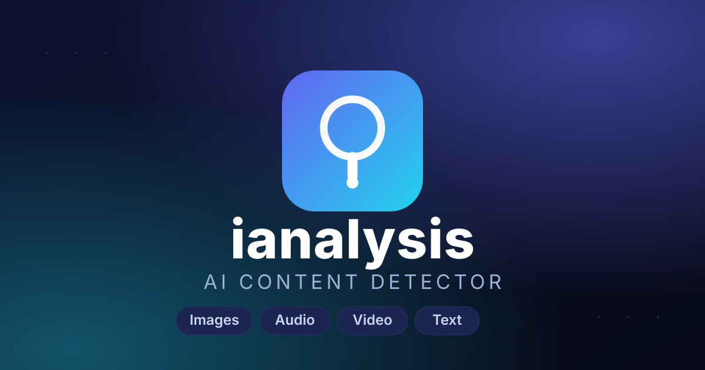

#  ianalysis — AI Content Detector

Web app that estimates whether an image, audio/video clip, or text was AI-generated.
Flask backend + modern web UI (English).

> ⚠️ Scores are probabilistic (0–100%), not conclusive proof. Heavy edits and
> strong compression degrade the signal — always gather additional evidence.

## Run

```bash
cd ianalysis
pip install -r requirements.txt
python app.py
```

Then open: http://127.0.0.1:5000

## API

| Endpoint | Method | Input | Output |
|---|---|---|---|
| `/api/detect-image` | POST | `file` (png/jpg/webp/bmp) | `{score, verdict, details}` |
| `/api/detect-audio` | POST | `file` (mp3/wav/m4a/mp4/webm) | `{score, verdict, details}` |
| `/api/detect-text` | POST | JSON `{"text": "..."}` | `{score, verdict, details, signals}` |

`verdict`: `ai_generated` / `uncertain` / `human`

## How detection works

- **Images** (`detector/image_detector.py`): EXIF/XMP/C2PA metadata scan for generator keywords + FFT frequency analysis + noise uniformity (Laplacian).
- **Audio** (`detector/audio_detector.py`): known TTS/voice-generator markers + spectral analysis for WAV files.
- **Video**: container metadata scan for generator markers.
- **Text** (`detector/text_detector.py`): lexical diversity, burstiness, repetition, formulaic phrases — English + Arabic.

## Notes

- High-quality, lightly compressed files give the best results.
- Heavy multi-step editing degrades detectability.

---

© 2026 salim-slimani. All rights reserved.
